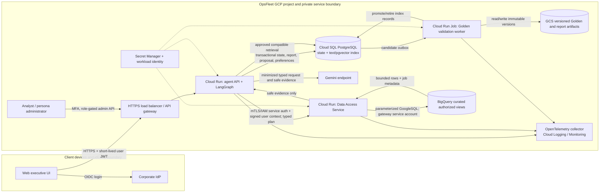
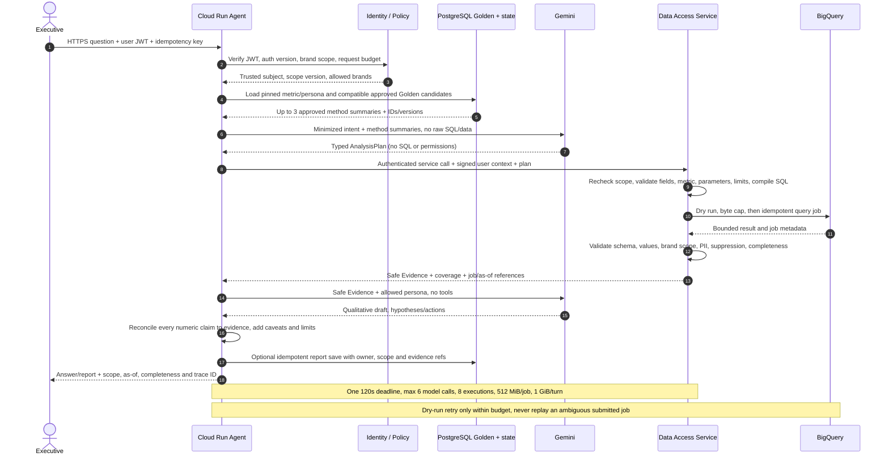
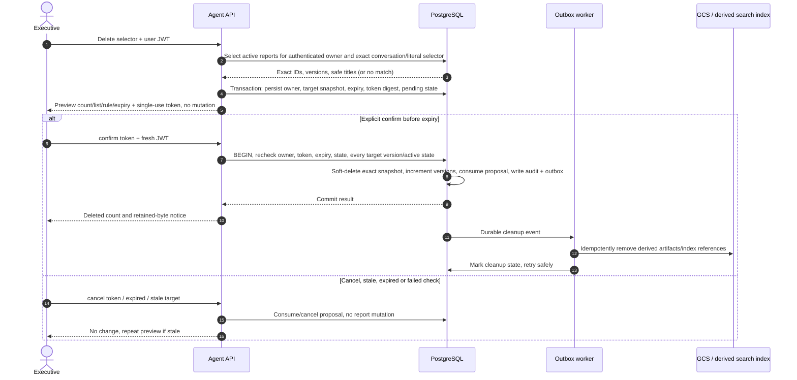
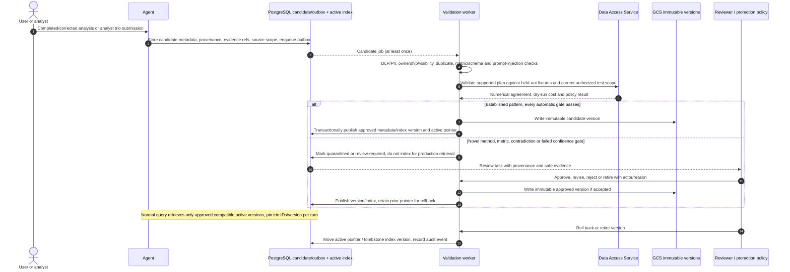

# OpsFleet retail analytics assistant — production HLD

**Status:** production target design, not deployed. The runnable prototype is a local Python CLI using SQLite and BigQuery public data. Nothing in this document asserts that Cloud Run, Cloud SQL, GCS, Vertex AI, managed telemetry, or production identity controls have been provisioned.

The prototype now includes bounded product-revenue, state purchaser-spend and country inactivity-change playbooks (Part 2, awaiting review); see [technical contracts](TECHNICAL_DESIGN.md#9-part-2-analytical-playbooks). These do not implement the production services below.

## 1. Scope and design assumptions

The production service gives authenticated executives evidence-backed analysis over private, curated retail data. It uses approved Golden methodology during normal analysis, applies user brand scope before aggregation, and keeps destructive report operations separate from model decisions. The application runs in a regional Google Cloud deployment. All values below are starting engineering assumptions for sizing and review, not client commitments or measurements.

| Dimension | Initial planning assumption | Validation needed |
|---|---:|---|
| Users / traffic | 200 named users; 20 concurrent analysis turns; 1,000 turns/day | Client adoption, peak patterns, tenant count |
| Golden corpus | 10,000 approved trios; normally retrieve at most 3 | Quality, brand-specific corpus growth, index recall |
| Request budget | 120 seconds total; 6 model calls; 8 warehouse executions; 512 MiB/job and 1 GiB/turn | Latency and cost tests using client data |
| SLO target | 99.5% monthly API availability; p95 under 45 seconds for analysis, excluding human review | Workload and provider baseline |
| State retention | Conversations/evidence 30 days; active reports per client policy; deletion tombstones/audit 1 year | Legal, privacy and records policy |
| Recovery target | PostgreSQL RPO 5 minutes / RTO 4 hours; GCS object version recovery 24 hours | Backup restore exercise and regional policy |
| Cost guardrail | Per-user and per-tenant daily model/warehouse budgets, initially alert at 70% and stop at 100% | Actual pricing, quotas, workload distribution |

Analysis can return verified partial evidence only if its completeness is explicit. Confirmation and approval waiting are durable asynchronous interactions; they never keep a request or model call open. The BigQuery source is assumed to be a client-owned curated analytical surface, not the public prototype dataset.

## 2. Deployment and trust boundaries

**Trust rules.** The IdP signs user JWTs. Agent and gateway independently validate algorithm, issuer, audience, expiry, role and brand claims; unknown signing keys, malformed claims, refresh failures and revoked authorization versions fail closed. Service identity is separate from end-user identity. The gateway verifies the authenticated agent service and a signed, short-lived user context, then checks current authorization version before every operation. Never accept scopes, persona instructions, or confirmation state from model output or unsigned headers.

Only the Data Access Service has the BigQuery query identity. It accepts an allowlisted typed operation with bounded parameters, never raw SQL. Its compiler injects canonical brand filters at order-item grain before any aggregate. Curated views omit direct identifiers and contact/address/coordinate fields. The gateway returns only validated aggregate or permitted pseudonymous customer evidence. Demographic groups below the configured threshold are suppressed, with complementary suppression and a query privacy budget to limit differencing. A shared BigQuery service account does not enforce each executive's brand scope by itself; gateway policy is authoritative unless a separately delegated warehouse identity/row-policy design is adopted.

The model provider receives minimized intent, an approved methodology summary, and released evidence. It has no database, deletion, email, or publication tools. Retrieved Golden prose is untrusted data and cannot override system policy. Do not send raw PII, raw source rows, raw historical SQL, credentials, or hidden chain-of-thought to the model or telemetry.

## 3. Services, protocols and tradeoffs

| Building block | Responsibility and identity | Benefit | Cost, alternative and limit |
|---|---|---|---|
| Cloud Run agent API | HTTPS request handling, LangGraph orchestration, policy coordination; dedicated workload identity | Autoscaling, managed runtime, stateless instances | Cold starts and request ceilings; external state required; GKE is more control and more operations |
| Data Access Service (Cloud Run) | Verify user context, deterministic authorization/compiler, BigQuery dry-run/job execution, result release; sole warehouse service identity | Isolates raw data and warehouse credentials from model-facing agent | Added hop, availability dependency, compiler must be carefully maintained; same service account does not provide warehouse-side user isolation |
| BigQuery | Curated views and bounded analytical queries | SQL analytics and scan estimates; dataset ownership boundary | Scan cost and changing data; scheduled aggregate marts may be cheaper/predictable for stable metrics |
| Cloud SQL PostgreSQL | Transactional reports, conversations, proposals, preferences, persona versions, audit/outbox and initial retrieval index | Transactions, constraints, PITR and mature operators | Connection/capacity cost and index tuning; Firestore is an alternative for document state but complicates relational ownership and deletion transactions |
| PostgreSQL text + pgvector | Initial hybrid keyword/vector retrieval over approved Golden methodology | One operational store and simple atomic status checks | Recall/scale limits to benchmark; a dedicated vector service may scale retrieval but introduces stale-index visibility checks and another dependency |
| GCS | Immutable source trios, approved artifacts, large exports; object versioning and lifecycle | Low-cost object durability and version history | Cross-store transactions do not exist; PostgreSQL outbox and idempotent worker coordinate publication/deletion |
| Cloud Run Job + DB outbox | Validate and promote candidates asynchronously | Durable retry state without holding user requests | Polling adds delay; add Pub/Sub only if throughput or latency requires it |
| Gemini (Vertex AI preferred) | Typed plan proposal and qualitative wording only | Managed Google boundary and structured generation fit | Quota/model drift and nondeterminism; test model versions and maintain safe checked-evidence fallback |
| Secret Manager, workload identity | API keys only where needed; short-lived service credentials | No static service-account key files | IAM setup and rotation operations; OpenRouter route needs explicit legal/privacy approval and is not an independent provider outage domain |
| OpenTelemetry + Cloud Monitoring/Logging | Sanitized correlated traces, metrics, dashboards, alerts | Managed operations and cross-service trace correlation | Telemetry cost and sensitive metadata risk; strict schema, access and retention are required |

All service calls use authenticated TLS. API to gateway carries a signed context containing subject, effective brands, role, authorization version, request ID and expiry; gateway verifies rather than trusts it. Gateway to BigQuery uses parameterized GoogleSQL and a job ID derived from an idempotency key. Cloud SQL uses private IP, TLS, bounded connection pools and separate DB roles. GCS objects are encrypted, versioned and referenced by immutable generation. Model requests use provider TLS, explicit region/data handling settings and strict payload minimization.

## 4. Analysis flow

The agent pins user authorization, metric, persona, compiler/schema and Golden versions for the full turn. Each follow-up revalidates current authorization and invalidates incompatible prior evidence. The gateway applies scope before grouping/aggregation, uses named bound parameters, dry-runs each statement and enforces job and cumulative limits. An empty result does not trigger broader dates, brands, statuses or products. An invalid SQL or schema result can cause one trusted recompilation from the same validated plan, then stops safely. Provider transient fallback is bounded and charged to the same budget; an alternate model must pass the same evaluation before production use.

## 5. Confirmed report deletion flow

The owner identity comes only from the verified JWT. Matching is literal, case-folded title/body search or exact conversation ID. Proposal selection is an immutable bounded snapshot; reports added after preview are excluded. Confirmation requires a dedicated command and a fresh authorization check. Duplicate confirmation is idempotent and cannot reveal report content. A concurrent update makes the whole operation stale rather than partially deleting. The PostgreSQL transaction soft-deletes records and records audit/outbox rows atomically. GCS and search cleanup is asynchronous, but every report read/search result performs an authoritative active-owner check before text is released.

Define retention before launch. Initial proposal: reports remain active until owner deletion or a tenant policy; soft-deleted report bodies are unavailable immediately, then primary bytes and derived artifacts are purged within 30 days; encrypted backups age out within 35 days; minimal tombstone/audit metadata is retained one year. Legal hold overrides purge only through a separate audited role. The current prototype has no purge, restore, GCS, backup, or report-derived search feature. Cloud SQL PITR plus encrypted scheduled backups should meet the assumed RPO/RTO, but a restore drill is a release gate; backups may retain soft-deleted bytes until expiry.

## 6. Golden candidate, approval, retrieval and rollback

Candidate sources remain distinct: analyst-authored, assistant-generated, corrected and imported. Positive user feedback only prioritizes review; it never auto-approves a claim. Validation independently checks supported plan, privacy, source scope/visibility, metric and schema compatibility, SQL cost, numerical references, report claim support, duplication and regression impact. Established patterns may auto-promote only if fixture/reference gates and calibrated confidence pass; novel methods, new metrics, contradictions, causal claims and unresolved privacy checks require human review. LLM judging can triage but cannot be the sole correctness gate.

Approved trio objects are immutable and versioned. The index contains only approved, active, compatible metadata plus minimized methodology embeddings; retrieval filters approval, source visibility, tenant/brand scope, metric/schema version and retirement state before any text is released. A database active-status check is authoritative even when a vector index is stale. Historical SQL is kept as reference/audit material and is never executed directly. Revalidate on metric/schema updates; maintain held-out evaluation families outside the learning corpus. Publish the GCS object first, then transactionally activate its metadata/index pointer; an outbox retries interrupted indexing. Rollback switches the pointer to a prior known-good version and retires the failed version without deleting provenance.

## 7. Operational state, learning, retention and extension

Cloud SQL owns relational truth. Separate DB roles and row-level owner keys protect conversations, reports and preferences. Required records: conversations and safe context; evidence metadata and bounded safe results/expiry; immutable reports and source scope; deletion proposal snapshot/digest/lifecycle; explicit and inferred user preferences with provenance/confidence/reset; versioned persona drafts and approved pointer; Golden metadata and approval; idempotent outbox jobs; audit events with actor/target/version/decision/trace. Do not persist raw prompts, raw warehouse rows, tokens, secrets, direct PII, or full model chain-of-thought. Large files live in encrypted GCS with PostgreSQL owner/status references.

**Learning and preferences.** Store tables/bullets, depth and chart/text preferences per verified user. Explicit choice overrides an inferred preference; inferred values carry confidence/source, are editable/resettable and expire. Preferences only affect presentation. System learning is the controlled Golden pipeline above; no automatic fine-tuning or weight update is implied. Evaluation families are isolated from candidates and promotion data.

**Persona agility.** A nondeveloper administrator uses an MFA-protected form for bounded style dimensions and safe report instructions. It previews representative sanitized examples, runs claim/PII/policy checks, records reviewer and evaluation evidence, then publishes a versioned approved pointer in PostgreSQL. New turns resolve the pointer; in-flight turns pin the old version. Cache refresh is bounded (target 60 seconds) and rollback changes the pointer without redeployment. Persona text cannot alter metrics, scope, required caveats, tool permissions, deletion confirmation or safety policy.

**Retries and failure ownership.** Agent owns one 120-second turn clock, model-call budget and user-facing partial/error status. SDK retries are disabled or counted; max six model calls and two plan repairs. Gateway owns query dry-run, 30-second query timeout, job cancellation, idempotency and byte budgets. Retry only transient dry-run/network failure when no query submission is ambiguous; never resubmit a possibly running billed job. Worker retries use outbox ID and object generation idempotency with exponential backoff and dead-letter/review state. PostgreSQL save/confirm failure means no success claim. Golden retrieval outage uses approved local/last-known-good methods if still compatible; otherwise disclose degraded analysis or decline method-dependent work. Invalid identity, revoked scope, permission error, unknown billing, policy failure or model refusal fails closed. No synthetic figures are ever a fallback.

**Observability.** Agent, gateway and worker emit OpenTelemetry trace/span IDs, safe stage/tool decisions, model and policy versions, Golden IDs/version, query job IDs, status/category, durations, retries, budget headroom, known bytes and token usage (with explicit unknown). No user text, prompt, SQL, parameter values, row content, report body, credential, token or high-cardinality user labels in telemetry. Restrict trace access; redact at source; retain detailed safe traces 30 days and aggregates 13 months pending client policy. Dashboards: turn outcomes by stage/provider; p50/p95/p99 latency; fallback and repair exhaustion; authorization/PII denials; query estimated/known/unknown bytes; empty/incomplete answers; store failures; Golden approval backlog/index age; persona version and rollback. Initial alert hypotheses: >5% errors over 15 minutes, any suspected policy escape, >2% unknown billing, p95 above 45 seconds for 15 minutes, or oldest promotion job over 30 minutes. Calibrate before launch and alert on trace references, not payloads.

**Extensions.** Each future tool needs a typed input/output contract, trusted user/scope context separate from model arguments, sensitivity classification, authorization check, timeout/cost budget, idempotency and audit policy. Charts render only released evidence and retain scope/as-of metadata. Email adds recipient allowlists, preview, content inspection and explicit send authorization; sending is a side effect distinct from report generation. Web search treats pages as untrusted, stores source attribution and cannot override warehouse facts/policy. These are designs, not prototype features.

## 8. Evaluation and release gates

Release only after independent numerical references cover joins/grain, mixed-brand orders, excluded statuses, null price, UTC start/end, empty populations and zero denominators; auth/privacy/ownership/revocation tests pass; report and deletion replay remain idempotent; transient/ambiguous failures are bounded; live BigQuery/model canary and fresh environment work; restore, persona no-deploy publish/rollback, Golden stale-index exclusion and dashboards/alerts are exercised. Report quality rubric: requested metric/population/period/comparison present; each number matches released evidence; completeness/coverage/caveats explicit; action item tied to a finding and feasible; unsupported causal language absent. Human reviewers score each category 0 (missing/incorrect), 1 (partial), 2 (complete and supported); LLM judge is triage only.

Executive UX study: recruit representative executives only with client approval, run neutral tasks for a simple question, follow-up/period change, report with actions, deletion preview/cancel/confirm, and one safe failure. Capture task completion without moderator rescue, clarification count, elapsed time to useful answer, target understanding (metric/date/scope/completeness), and deletion target understanding. Do not infer satisfaction without asking participants. No human participants or task time were observed in this prototype phase. See [evaluation methodology and UX limits](TECHNICAL_DESIGN.md#7-evaluation-method-and-verification-limits).

## 9. Prototype substitutions and material limits

The local prototype now includes deterministic report/conversation navigation and an in-process shortcut for a successfully displayed deletion proposal. Report reads and deletion-preview titles recheck current catalog scope and saved semantic support before disclosure; this is a bounded catalog dependency, with no new business analysis or model calls. The shortcut delegates to the persisted explicit-token transaction and cannot survive a process restart. These are SQLite/CLI contracts, not the production JWT/API/PostgreSQL/outbox services described above. See the Part 3 contracts in TECHNICAL_DESIGN.md.

The current prototype is one local process with Typer/Rich, LangGraph, a direct Gemini adapter and authorized OpenRouter Gemini fallback, a trusted Python/SQLGlot compiler, read-only public BigQuery access, SQLite, local authored Golden JSON, local sanitized JSONL diagnostics and seeded `--user` identity. It has no production frontend, verified JWT, Data Access Service, Cloud Run deployment, private curated warehouse, Cloud SQL, GCS, PostgreSQL vector index, approval worker, managed telemetry, persona UI, preference persistence or chart/email/web tools. Prototype deletion retains bytes in SQLite; local trace durability is best effort. The demo identity is not authentication. The matched live Golden run selected a method the model already proposed; only the held-out offline baseline comparison demonstrates causal method change. See the [technical explanation](TECHNICAL_DESIGN.md) and [setup and limitations](README.md#definitions-and-limits).

**Prototype status — 6 November 2026.** Structured interpretation, trusted UTC role resolution, bounded context/pending state, scalar temporal comparison, factual grounding, report composition/completeness and executive CLI presentation are implemented. Exact save reuses unchanged released evidence. A save that changes analysis or report preferences clarifies without saving; the user must request and review the change separately. One bounded report-choice interpretation repair may remove model-added defaults, but never executes a modified save. Input is limited to 12,000 characters, interpretation output to 5,000 tokens and explanation selection to 2,000. Mandatory safety, confirmation, resilience and observability controls are prototype code; production services and learning/persona/extension designs above remain targets. [Verification and limits](README.md#offline-verification) distinguish offline tests, targeted live observations across adjacent freezes and the historical full evaluation. Human UX and production readiness are not established.

Part 5 prototype validation now has a version-bound offline/preparation path, a Python 3.12/3.13 offline CI definition, guarded owner-terminal provider/warehouse trials and a proposed human protocol. These do not implement production services or establish production readiness. See the [Part 5 validation specification](docs/validation/part5-v1/SCENARIOS.md) for the separate acceptance layers. Execution artifacts and local session reports are kept outside version control.
